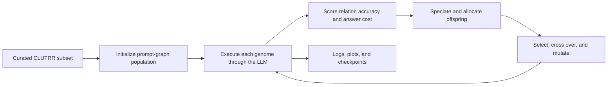

# ERA: Evolving Reasoning Agents

[Paper (PDF)](ERA.pdf) · [Implementation updates](<ERA PRoject Course Updates.pdf>) · [MIT License](LICENSE)

ERA is a research prototype for evolving LLM reasoning agents. It searches over the
content and structure of prompts instead of updating model weights: each agent is a
directed acyclic graph (DAG) of natural-language reasoning instructions, evaluated and
refined through an evolutionary loop.

This repository contains CLUTRR and StepGame code. The archived experiments currently
documented here are for **CLUTRR only**; the presence of a StepGame runner does not imply
that StepGame experiments have been completed.

## Paper

The attached paper describes the original ERA design. The course update document records
later implementation changes and experiments. This README describes the code in this
repository, which has changed since the original paper; use the source and experiment
configuration here when reproducing the results below.

> Filippo Adami, Alessandro De Vidi, Edoardo Di Tommaso, and Carlo Zamuner.
> “ERA: Evolving Reasoning Agents.” *IEEE Transactions on Evolutionary Computation*,
> vol. 30, no. 1, January 2026. [PDF](ERA.pdf)
>
> DOI / arXiv identifier: **to be added**.

```bibtex
@article{adami2026era,
  title   = {ERA: Evolving Reasoning Agents},
  author  = {Adami, Filippo and De Vidi, Alessandro and Di Tommaso, Edoardo and Zamuner, Carlo},
  journal = {IEEE Transactions on Evolutionary Computation},
  volume  = {30},
  number  = {1},
  year    = {2026},
  note    = {DOI or preprint identifier to be added}
}
```

## How ERA works

An agent genome is a DAG of `PromptNode` genes connected by directed edges. The genome
stores prompt text, semantic embeddings, and innovation identifiers. Topology mutations
check graph reachability and acyclicity so valid reasoning paths remain executable.

At evaluation time, a phenotype topologically orders its genome. Each node receives the
problem and the instructions and responses of its parent nodes, then calls the shared LLM
client. The final node is asked for a short answer. For CLUTRR, outputs are normalized to a
canonical kinship relation before scoring. Fitness rewards correct answers and applies
adaptive penalties for token usage and answers longer than two words; token counts in the
current implementation are estimated from text length.

Across generations, the system applies prompt mutations (including expansion,
simplification, reformulation, persona/reasoning edits, and node splitting) and graph
mutations (adding or removing nodes and connections). Species are grouped by overlap in
node innovation identifiers. A dynamic compatibility threshold and fitness sharing help
allocate the next population across species; rank-based parent selection, crossover,
elitism, and mutation produce the next generation.



## Repository layout

| Path | Purpose |
| --- | --- |
| `curated_main_clutrr.py` | Current CLUTRR experiment runner |
| `curated_main_stepgame.py` | StepGame runner; no StepGame results are included here |
| `ERA/` | Initial population creation |
| `Gene/`, `Genome/` | Prompt-node and connection genes; DAG genome operations |
| `Phenotype/`, `Traits/` | Runtime execution of a genome against a problem |
| `Mutations/`, `Crossover/`, `Selection/`, `Species/` | Evolution operators and species management |
| `Fitness/` | CLUTRR answer scoring and population evaluation |
| `Data/CLUTRR/`, `Data/StepGame/` | Dataset loading, prompt construction, and dataset analysis |
| `Utils/` | LLM and embedding client, logging, plots, checkpoints, and cleanup |
| `Z_Baselines/` | Baseline and best-individual evaluation routines |
| `Tests/` | Unit and usage tests |
| `Models/bge-base-en-v1.5/` | Local sentence-embedding model cache, when present |
| `Utils/Logs_CLUTRR/` | Archived CLUTRR run logs and plots included with this workspace |

## Setup

Use Python 3.10 or newer and install the listed dependencies in a virtual environment:

```bash
python3 -m venv .venv
source .venv/bin/activate
pip install -r requirements.txt
```

The runner expects an LLM server to be started separately. Its defaults in
`curated_main_clutrr.py` are model `google/gemma-3-1b-it` and base URL
`http://localhost:8000`. The default client sends completion requests to
`/v1/completions` and expects an OpenAI-compatible response. `Utils/LLM.py` also contains
an Ollama path when the configured base URL contains port `11434`; update `MODEL_NAME` and
`BASE_URL` in the runner to match the server you use.

The BGE sentence-embedding model is loaded from `Models/bge-base-en-v1.5/` when available;
otherwise the client downloads it on first use. CLUTRR is loaded from the local
`Data/CLUTRR/clutrr_gen_train234_test2to10/` cache or downloaded from the configured
Hugging Face dataset source, then cached locally. The runner freezes each sampled subset
as `Data/CLUTRR/curated_clutrr_subset_<id>.json` so later runs with the same subset ID reuse
the saved examples.

## Run an experiment

From the repository root, pass a subset ID and a run ID:

```bash
python curated_main_clutrr.py 2 0
```

The runner uses 50 individuals, runs for at most 50 generations, and may stop earlier if
fitness reaches 50 or the 15-hour time limit is reached. Supported subset IDs are:

| ID | Curated 90-example subset |
| ---: | --- |
| `0` | Five examples per kinship relation, sampled across reasoning levels |
| `1` | Stratified across reasoning levels: 28 examples from each of levels 2–4 and one from each higher level |
| `2`–`10` | 90 examples from the corresponding reasoning-hop level |

IDs `0` and `1` are sampling strategies, not hop counts. The command-line run ID labels
the output directory; it is not used as a random seed. The archived campaign contains
run IDs `0`, `1`, and `2` for every subset ID.

During execution, checkpoints are stored in the shared `era_checkpoints/` directory and
the runner resumes the latest checkpoint it finds. The checkpoint directory is not keyed
by subset or run ID, so clear it before starting a different experiment if it contains a
checkpoint left by an interrupted run. The legacy `run_all.py` still targets
`curated_main.py`, which is absent from this checkout; use `curated_main_clutrr.py` for
individual CLUTRR runs.

The archived logs are under
`Utils/Logs_CLUTRR/Logs_<subset-id>_hops_<run-id>/`. The current `Logger` and `Plotter`
classes write to `Utils/Logs_<subset-id>_hops_<run-id>/` (without the `Logs_CLUTRR/`
parent), so archived and newly generated artifacts may be in different locations.

## CLUTRR results in this workspace

The archive contains **33 runs**: 11 subset IDs, each with three run IDs. All 33 logs
contain a generation 50 summary. The table reports the mean across the three runs for each
subset; ranges are the minimum and maximum run values.

| Subset ID | Zero-shot baseline accuracy | Few-shot baseline accuracy | Generation 50 best subset accuracy | Final best-accuracy individual on all splits |
| ---: | ---: | ---: | ---: | ---: |
| 0 | 7.78% | 15.56% | 23.33% (21.11–25.56) | 16.47% (16.23–16.93) |
| 1 | 8.89% | 24.44% | 25.19% (23.33–26.67) | 16.59% (15.08–19.29) |
| 2 | 20.00% | 31.11% | 33.70% (30.00–38.89) | 19.87% (18.47–21.42) |
| 3 | 14.44% | 21.11% | 27.04% (26.67–27.78) | 16.48% (13.38–20.54) |
| 4 | 17.78% | 24.44% | 30.37% (28.89–33.33) | 18.41% (17.48–20.04) |
| 5 | 15.56% | 18.89% | 27.04% (26.67–27.78) | 16.63% (15.76–17.90) |
| 6 | 11.11% | 25.71% | 18.73% (16.19–20.00) | 15.87% (13.68–18.14) |
| 7 | 4.44% | 16.67% | 21.11% (18.89–24.44) | 14.11% (10.12–19.37) |
| 8 | 10.00% | 11.11% | 23.70% (23.33–24.44) | 16.77% (14.93–18.59) |
| 9 | 8.89% | 22.22% | 16.67% (15.56–17.78) | 13.11% (10.37–16.80) |
| 10 | 4.44% | 21.11% | 14.81% (13.33–15.56) | 13.13% (8.08–16.51) |

Across all 33 runs, the generation 50 best accuracy on the 90-example subset averaged
**23.79%** (range **13.33–38.89%**). The initial zero-shot and few-shot baselines averaged
**11.21%** and **21.12%**, respectively, on those same subsets. The final best-accuracy
individual averaged **16.13%** (range **8.08–21.42%**) when evaluated on 16,131 examples.

**Baseline metrics:** Both baselines are measured at generation 0 on the same 90-example
subset used for that run.

**All-split metric:** Each end-of-run score evaluates the individual selected by its
subset accuracy on all available CLUTRR splits (`train`, `validation`, and `test`), 16,131
examples in total. The curated subsets are also sampled across those splits. These figures
are therefore not held-out test accuracy, and the baseline and all-split columns are not a
matched comparison. The three run IDs are descriptive repetitions, not controlled random
seeds; the runner does not seed its evolutionary randomness.

The original paper and later updates discuss earlier configurations and exploratory
results. The table above is calculated from the beginning and end of the archived
`generation_logger.md` files and describes the current CLUTRR run set only. See, for
example, [subset 2, run 0](Utils/Logs_CLUTRR/Logs_2_hops_0/generation_logger.md).

## License

This project is distributed under the [MIT License](LICENSE).
